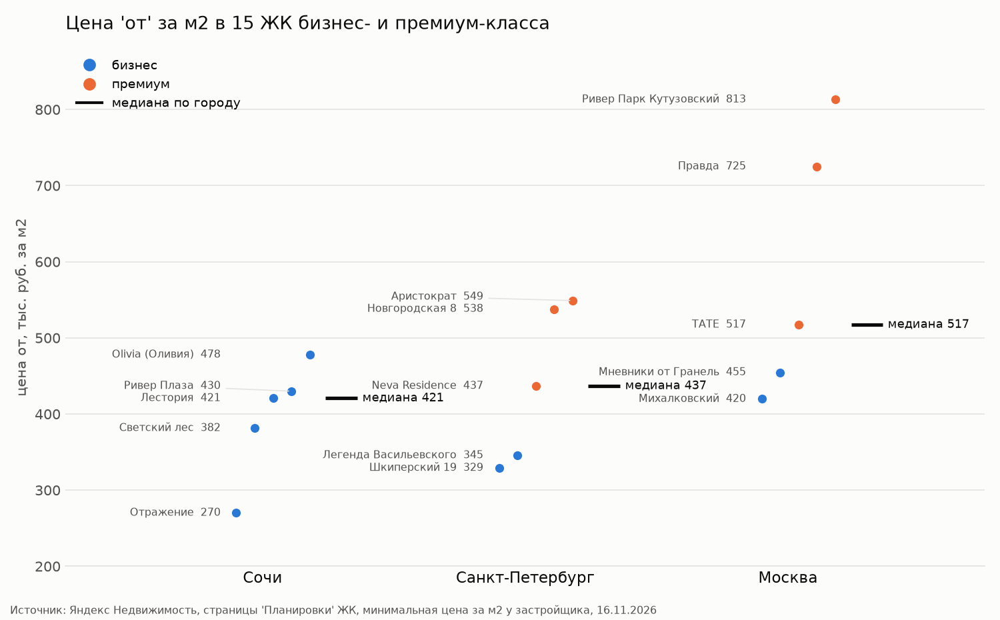

# Тестовое задание: ЖК бизнес- и премиум-класса, подборщик и AI-инструмент

Кандидат: Максим Дёмкин. Сделаны все части: Часть 1, оба трека (А "Код" и Б "Бизнес") и Часть 3.

## Что где лежит

| Файл | Что внутри |
|---|---|
| [data/complexes.xlsx](data/complexes.xlsx), [data/complexes.csv](data/complexes.csv) | Часть 1: таблица 15 ЖК, у каждой строки ссылка на источник, дата проверки и как получена цифра |
| [charts/price_by_city.png](charts/price_by_city.png) | График: цена от за м2 по городам, точки - отдельные ЖК |
| [data/raw/](data/raw) | Сырые выгрузки со страниц, из которых собрана таблица |
| [matcher.py](matcher.py), [tests/](tests) | Трек А: подборщик (CLI) и тесты |
| [web/index.html](web/index.html) | Трек А: та же логика в виде веб-страницы |
| [screenshots/](screenshots) | 3 скриншота страницы и вывод CLI |
| [BUSINESS.md](BUSINESS.md) | Трек Б: AI-инструмент для агентства + 3 сценария роликов |
| [AI_WORK.md](AI_WORK.md) | Часть 3: промпты, ошибки нейросети, время, что было сложным |
| [AI_LOG.md](AI_LOG.md) | Подробный журнал работы с ИИ по шагам |
| [scripts/](scripts) | Сборка таблицы, графика и данных для страницы |

## Часть 1. Данные

Города: Сочи, Москва и Санкт-Петербург (по 5 ЖК). Петербург выбран как крупный рынок новостроек
высокого класса, где застройщики публикуют цены по каждой планировке.

**Источник и метод, одинаковые для всех 15 строк.** Яндекс Недвижимость, страница "Планировки" ЖК
(только квартиры застройщика). "Цена от" = минимальная "от X руб за м2" среди всех планировок ЖК по
всем страницам. Срок сдачи и класс берутся из карточки ЖК. Дата проверки 16.11.2026. В примечании к
каждой строке указана квартира, по которой получен минимум (комнатность, площадь, цена), чтобы
цифру можно было пересчитать вручную.

**Как проверить любую строку за 30 секунд:** открыть ссылку из колонки "ссылка на источник (цена)",
нажать "Сортировать: по цене за м2", первая планировка в списке и есть цена "от". Срок сдачи и
класс видны справа в блоке ЖК. Цены живые, поэтому через несколько дней цифра может немного сдвинуться.

**Контрольная перепроверка 16.11.2026** (повторно открыл 5 страниц в браузере и отсортировал сайтом,
то есть независимо от моего скрипта):

| ЖК | Первая планировка после сортировки по цене за м2 | Срок и класс в карточке | Совпало с таблицей |
|---|---|---|---|
| Отражение (Сочи) | 3 комнаты 107,3 м2, 28 981 800 - 40 789 200 руб, от 270 000 руб за м2 | сдан, бизнес | да |
| ТАТЕ (Москва) | 3 комнаты 81,3 м2, 41 701 608 - 44 990 692 руб, от 517 197 руб за м2 | 2 кв. 2027, элитный | да |
| Ривер Парк Кутузовский (Москва) | студия 41,1 м2, 33 428 396 - 33 903 224 руб, от 813 343 руб за м2 | 4 кв. 2026 - 3 кв. 2027, элитный | да |
| Аристократ (СПб) | 2 комнаты 58,4 м2, 32 083 560 - 32 609 520 руб, от 549 000 руб за м2 | 2 кв. 2029 - 4 кв. 2030, элитный | да |
| Шкиперский 19 (СПб) | 2 комнаты 70,1 м2, 1 этаж, 23 096 408 руб, 329 478 руб за м2 | 2 кв. 2027, есть сданные, бизнес | да |

Почему не ЦИАН: в момент работы ЦИАН показывал капчу даже в обычном браузере. Почему не список
объявлений: в него попадают вторичка и квартиры из других домов, цена "от" получается заниженной.

Класс: Яндекс делит на "бизнес" и "элитный". "Элитный" в таблице записан как "премиум".



### Выводы

1. **Дороже всего Москва.** Медиана 517 тыс. руб за м2 против 437 тыс. в Петербурге и 421 тыс. в
   Сочи. Самый дорогой ЖК выборки, "Ривер Парк Кутузовский" (813 тыс.), в 3 раза дороже самого
   доступного, сочинского "Отражения" (270 тыс.).
2. **Бизнес-класс в Сочи стоит как московский, а Петербург заметно дешевле.** Сочинский бизнес:
   270-478 тыс., медиана 421 тыс. Московский: 420-455 тыс. "Оливия" в Адлере (478 тыс.) дороже обоих
   московских бизнес-ЖК. Петербургский бизнес на Васильевском острове: 329-345 тыс., примерно на 20%
   дешевле сочинской медианы.
3. **Класс не гарантирует цену.** Петербургский премиум Neva Residence (437 тыс.) дешевле
   сочинского бизнеса "Оливия" (478 тыс.) и московского бизнеса "Мневники от Гранель" (455 тыс.).
   Цена "от" считается по самой выгодной квартире: в Neva Residence это квартира в уже сданном корпусе.
4. **Что удивило: премиум в Сочи почти целиком апартаменты.** В фильтре "элитный" по Сочи на
   Яндексе 14 объектов: 12 из них апарт-отели, гостиничные комплексы или МФК, 1 (Mantera Residence)
   находится в Сириусе, а не в Сочи, и только 1 настоящий ЖК ("Моретта"), но без опубликованных цен.
   Поэтому в Сочи в таблице 5 ЖК бизнес-класса. Для сравнения: гостиничный комплекс "Скайвиль" в
   Красной Поляне продается от 1 000 000 руб за м2 (апартаменты 49,7 м2 от 49 470 000 руб,
   [источник](https://realty.yandex.ru/sochi/kupit/novostrojka/skajvil-4102021/planirovki/),
   16.11.2026), почти вдвое дороже московского премиального "ТАТЕ".
5. **Средняя цена и цена "от" сильно расходятся.** У "Отражения" средняя цена за м2 на Яндексе
   380 тыс., а минимальная у застройщика 270 тыс. Нейросеть в поиске на вопрос о цене "от" ответила
   средней, а заодно назвала неверный срок сдачи (подробно в [AI_WORK.md](AI_WORK.md)).

## Трек А. Подборщик

Пользователь вводит город, бюджет и площадь, программа считает примерную стоимость квартиры
(цена от за м2 * площадь), оставляет ЖК, которые влезают в бюджет, и показывает 3 самых близких к
бюджету снизу. Если ничего не подходит, показывает самый доступный ЖК в городе и сколько метров там
можно купить на эти деньги. Неизвестный город, нулевой или отрицательный бюджет дают понятное
сообщение.

Запуск (нужен только Python 3.10+, без установки пакетов):

```bash
python3 matcher.py --city Сочи --budget 30000000 --area 60
```

```bash
python3 matcher.py --city СПб --budget 25000000 --area 55
```

Тесты:

```bash
python3 -m unittest discover -s tests -v
```

Веб-версия: открыть `web/index.html` в браузере (работает и без сервера). Данные страница берет из
`web/data.js`, который генерируется из того же CSV командой `python3 scripts/build_web_data.py`.

## Как пересобрать таблицу и график

Нужны openpyxl и matplotlib:

```bash
python3 -m venv .venv && .venv/bin/pip install openpyxl matplotlib
```

```bash
.venv/bin/python scripts/build_table.py && .venv/bin/python scripts/make_chart.py && python3 scripts/build_web_data.py
```

Исходные строки таблицы лежат в `scripts/rows.py`.
